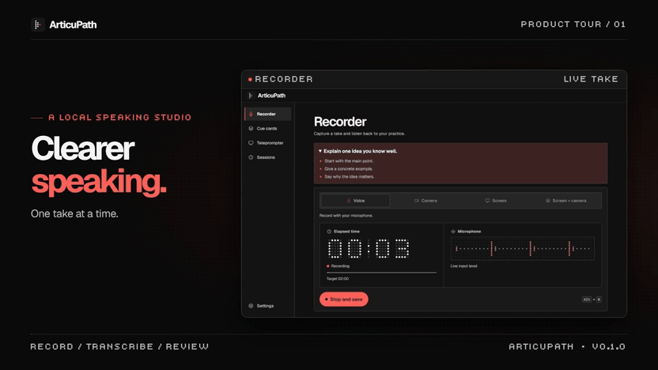

  

<h1 align="center">Rehearsal</h1>

A local studio for practicing spoken English and rehearsing presentations.

  <a href="https://github.com/aasmanbashyal/rehearsal/releases/tag/v0.2.0"><strong>Download v0.2.0</strong></a>
  · <a href="#watch-the-demo">Demo</a>
  · <a href="#your-first-take">Your first take</a>
  · <a href="docs/build.md">Build from source</a>

## Watch the demo

[Download the 22-second demo with sound (MP4)](https://github.com/aasmanbashyal/rehearsal/releases/download/v0.1.0/articupath-demo.mp4)

## Get Rehearsal

Version 0.2.0 shipped as **ArticuPath**. The installers and demo below use that name. To run Rehearsal from this checkout, follow the [build instructions](docs/build.md).

| Platform | Install |
| --- | --- |
| Windows 11 x64 | [Download the installer](https://github.com/aasmanbashyal/rehearsal/releases/download/v0.2.0/ArticuPath-Setup-windows-x64.exe). Run it, then open **ArticuPath** from the Start menu. |
| Ubuntu 24.04 x64 | [Download the DEB](https://github.com/aasmanbashyal/rehearsal/releases/download/v0.2.0/articupath_0.2.0-1_amd64.deb). Run `sudo apt install ./articupath_0.2.0-1_amd64.deb`, then open **ArticuPath** from the app menu. |
| Browser | With Bun, Rust, FFmpeg, and ffprobe installed, run `bun start` from the checkout and open [127.0.0.1:4317](http://127.0.0.1:4317/). See [build prerequisites](docs/build.md). |

Recording works without a transcription model. For transcripts, install the suggested Parakeet 110M model from the first-launch prompt or **Settings → Transcription models**. The model takes 129 MiB and runs offline after setup.

## Your first take

1. **Choose what to say.** Draw from 90 built-in cue cards, import your own TXT or CSV topic list in **Settings → Cue cards**, or paste a presentation into **Teleprompter** and set the scroll speed.
2. **Record a take.** Choose voice, camera, screen, or screen with a camera inset. You can also import a recording from **Sessions**.
3. **Listen back.** Select a transcript line to jump to that moment. Search for a phrase, export captions, or compare a scripted take with what you planned to say.

Use **Sessions** to tag takes and browse them by date. The [practice guide](docs/practice.md) covers recording limits, script review, and optional feedback.

## Where your data goes

Rehearsal saves recordings and transcripts on your computer and transcribes locally. If you choose OpenAI feedback in **Settings** and request feedback, Rehearsal sends the prompt and transcript text to OpenAI. You can also use local Ollama or copy the prompt to use elsewhere.

See the [practice guide](docs/practice.md#storage-and-backups) for data locations and backup tips.
